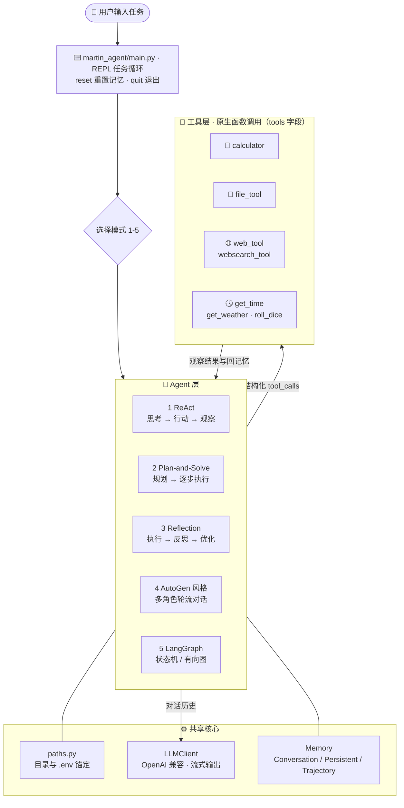

<div align="center">

# 🤖 MartinAgent

**从零手写的命令行 AI Agent —— 用纯 Python 把 ReAct / Plan-and-Solve / Reflection 讲明白**

*Without heavy frameworks. Just you, Python, and the LLM.*

[](https://github.com/Seven-second-fish/MartinAgent/actions/workflows/ci.yml)
[](https://www.python.org/)
[](https://platform.openai.com/docs/api-reference)
[](./VERSION)
[](./LICENSE)
[](#-注意)
[](#-贡献)

[快速开始](#-快速开始) · [Agent 模式](#-五种-agent-模式) · [内置工具](#-内置工具) · [项目结构](#-项目结构) · [测试](#-测试) · [学习路线](#-学习路线)

</div>

> [!IMPORTANT]
> **学习声明**：本项目仅用于学习与研究目的。请勿使用 AI 对本项目进行修改或自动改动。

MartinAgent 是一个跑在终端里的迷你 Agent 框架：前四种模式不依赖 LangChain / AutoGen 等重型框架，
一行一行实现 **工具调用、多轮规划、自我反思、多角色协作** 的完整闭环；
第五种模式（LangGraph）用状态机写法对照前面手写实现的差别。
支持任意 **OpenAI 兼容 API**（OpenAI / DeepSeek / 智谱 GLM 等），
工具调用与结构化输出统一走 **原生函数调用**（`tools` 字段），没有脆弱的正则解析层。

---

## ✨ 核心特性

- 🔁 **五种 Agent 范式** —— ReAct、Plan-and-Solve、Reflection、AutoGen 风格多角色、LangGraph 状态机，一键切换对照着学
- 🛠️ **原生函数调用** —— 工具调用与结构化输出都走 API 的 `tools` 字段，模型填参数表而不是自由写 JSON，从源头避免解析错误
- 🌊 **流式输出** —— 思考过程逐字打印到终端，看得见 Agent 怎么想
- 🧰 **开箱即用的 7 个工具** —— 计算、文件沙箱、网页抓取、网页搜索、时间、天气、掷骰子
- 🧠 **双记忆实现** —— 进程内 `ConversationMemory` 或落盘 `PersistentMemory`（`logs/memory.json`），重启自动加载
- 📁 **路径不随 cwd 漂移** —— 运行时目录统一由 `martin_agent/paths.py` 锚定到仓库根目录下
- 🔌 **OpenAI 兼容** —— 改两个环境变量即可接入 DeepSeek / 智谱 / OpenAI 任一服务商
- ➕ **加工具只要 3 步** —— 写一个模块、导出 4 个约定字段、注册进字典
- ✅ **带 pytest 用例** —— 仓库根目录 `python -m pytest` 一把跑完

## 🧭 架构总览



## 🎭 五种 Agent 模式

| | 范式 | 一句话流程 | 适用场景 |
|:---:|---|---|---|
| `1` | 🔄 **ReAct** | Thought → Action → Observation，边想边做循环迭代 | 需要多轮调用工具的即时问答类任务 |
| `2` | 📋 **Plan-and-Solve** | Planner 先拆解为有序步骤 → Executor 按步执行 | 步骤清晰、可预先规划的多步任务 |
| `3` | 🔍 **Reflection** | 先产出初稿 → 自我评审（submit_review）→ 按反馈迭代优化 | 代码等需要质量打磨的生成类任务 |
| `4` | 👥 **AutoGen 风格** | 四个角色（产品/工程/评审/用户）共享历史轮流发言，出现 `TERMINATE` 结束 | 需要多视角协作、边写边审的生成任务 |
| `5` | 🕸️ **LangGraph** | 把执行流程建模为状态机（节点=计算步骤，边=跳转逻辑） | 想对照「框架写法 vs 手写写法」的差异 |

> 💡 Planner 提交计划走 `submit_plan`、Reflection 提交评审走 `submit_review` —— 都是用函数调用承载的结构化输出，让模型「填参数」而不是「编 JSON」。
> 🔧 模式 5 需要额外依赖：`pip install langchain-core langgraph`。

## 🚀 快速开始

在仓库**根目录**操作：

### 1️⃣ 创建虚拟环境并安装依赖

```bash
cd MartinAgent

# 创建虚拟环境（放在 .venv，编辑器/IDE 能自动识别）
python3 -m venv .venv
source .venv/bin/activate        # Linux / macOS
# .venv\Scripts\Activate.ps1     # Windows PowerShell（推荐）
# .venv\Scripts\activate.bat     # Windows cmd

# 装依赖，二选一：
pip install -e ".[dev,langgraph]"        # 日常开发：装包 + 依赖（版本取最新兼容）
# pip install -r requirements-dev.txt    # 需要完全可复现的环境时：按锁文件精确安装

# 验证
python -c "import martin_agent, openai; print('安装成功')"
```

> 🔒 `requirements*.txt` 是 `pip-compile` 从 `pyproject.toml` 自动生成的**锁文件**，不要手改。
> 改依赖请改 `pyproject.toml` 后在仓库根目录重新生成：
> `pip-compile --strip-extras --output-file requirements.txt pyproject.toml`

> 💡 `pip install -e .` 会把 `martin_agent` 包注册进当前环境，之后**在任意目录**都能
> 用 `martin-agent` 命令或 `python -m martin_agent.main` 启动，不再依赖「必须先 cd 到某个目录」。

### 2️⃣ 配置 API Key

```bash
cp .env.example .env
```

编辑 `.env`，最小配置示例（DeepSeek）：

```dotenv
OPENAI_API_KEY=your-api-key-here
OPENAI_BASE_URL=https://api.deepseek.com/v1
MODEL_NAME=deepseek-chat
```

常用 Base URL 参考：

| 服务商 | Base URL |
|---|---|
| DeepSeek | `https://api.deepseek.com/v1` |
| OpenAI | `https://api.openai.com/v1` |
| 智谱 GLM | `https://open.bigmodel.cn/api/paas/v4` |

<details>
<summary>🔧 虚拟环境损坏了怎么办？</summary>

```bash
deactivate                                # 先退出虚拟环境
rm -rf ~/project/MartinAgent/.venv        # 删除损坏的目录
python3 -m venv .venv                     # 重新创建，重复第 1 步
```

</details>

### 3️⃣ 启动

```bash
martin-agent
# 等价写法（未安装为命令时）：
# python -m martin_agent.main
```

启动后先选模式（`1` ReAct / `2` Plan-and-Solve / `3` Reflection / `4` AutoGen 风格 / `5` LangGraph），
然后按轮输出思考过程（流式），ReAct 最多 8 轮工具迭代。

## ⚙️ 环境变量

| 变量 | 必填 | 说明 |
|---|:---:|---|
| `OPENAI_API_KEY` | ✅ | API 密钥 |
| `OPENAI_BASE_URL` | ✅ | 接口地址（任何 OpenAI 兼容服务） |
| `MODEL_NAME` | ✅ | 模型名，如 `deepseek-chat`、`gpt-4o-mini`、`glm-4-flash` |
| `WEB_SEARCH_API` | 可选 | 博查搜索 API Key，启用 `websearch_tool` 时需要 |
| `DEFAULT_CITY` | 可选 | 天气默认城市；问「今天天气」且未指定城市时使用 |

完整注释见 [`.env.example`](.env.example)。⚠️ 密钥不要提交进 Git。

## 💬 使用指南

| 输入 | 行为 |
|:---|---|
| 任务描述 | 开始执行任务 |
| `reset` | 清空对话记忆（若启用持久化，同步清空 `logs/memory.json`） |
| `quit` | 退出（也可 `Ctrl+C` 中断当前任务继续输入） |

试着丢给 Agent 这几类任务：

```text
帮我算一下 sqrt(144) + 3 * 5          # → calculator
现在几点了？上海天气怎么样？            # → get_time + get_weather
把「hello」写入 notes.txt，再读出来     # → file_tool
搜一下最近的 AI 新闻                   # → websearch_tool（需配置博查 Key）
```

> 📂 文件读写被限制在 `workspace/` 沙箱内，跑不了别的路径。

## 🛠️ 内置工具

| 工具名 | 说明 | 依赖 |
|---|---|:---:|
| 🧮 `calculator` | 数学计算 | — |
| 📂 `file_tool` | 在 `workspace/` 沙箱内读写文件 | — |
| 🌐 `web_tool` | 抓取网页纯文本（仅 http/https，有超时与长度限制） | — |
| 🔍 `websearch_tool` | 网页搜索，返回最相关的 3 条结果（标题/链接/摘要） | 博查 API Key |
| 🕓 `get_time` | 当前日期与时间 | — |
| 🌦️ `get_weather` | 查询城市天气，未指定时用默认城市 / IP 定位 | — |
| 🎲 `roll_dice` | 掷骰子 | — |

### ➕ 添加新工具只需 3 步

1. 在 `martin_agent/tools/` 新建模块，导出四个约定成员：
   `NAME` · `DESCRIPTION`（写清输入格式与示例）· `PARAMETERS`（JSON Schema）· `run(input: str) -> str`
2. 在 [`martin_agent/tools/__init__.py`](martin_agent/tools/__init__.py) 的 `TOOLS` 字典中注册 —— `build_tool_schemas()` 会自动生成 OpenAI `tools` 字段
3. 完成！异常请转为错误字符串返回，供模型自纠，避免抛穿 Agent 主循环

## 📁 项目结构

```text
MartinAgent/
├── pyproject.toml            # 包元数据 / 依赖 / entry point / pytest / 覆盖率（单一来源）
├── requirements.txt          # 锁文件：核心依赖的精确版本（pip-compile 生成）
├── requirements-dev.txt      # 锁文件：dev + langgraph 的精确版本（pip-compile 生成）
├── LICENSE                   # MIT
├── CHANGELOG.md              # 变更记录
├── .gitattributes            # 换行符规范化
├── .editorconfig             # 跨编辑器统一缩进/换行
├── AGENT.md / CLAUDE.md      # 给 AI / 开发者的仓库约定（内容一致）
├── LEARNING_PLAN.md          # 分阶段学习计划
├── VERSION                   # 版本号（被 pyproject.toml 读取）
├── .github/workflows/ci.yml  # CI：自动跑测试（Ubuntu + Windows）
├── martin_agent/             # 📦 包根：import martin_agent
│   ├── main.py               # 入口：模式选择 + REPL
│   ├── paths.py              # 🧭 目录与 .env 统一锚定（不依赖启动目录）
│   ├── core/                 # 🤖 Agent 与 LLM 客户端
│   │   ├── react_agent.py         # 模式 1：ReAct 主循环
│   │   ├── plan_solve_agent.py    # 模式 2：Planner + Executor
│   │   ├── reflection_agent.py    # 模式 3：执行 → 反思 → 优化
│   │   ├── autogen_agent.py       # 模式 4：多角色轮流对话（手写）
│   │   ├── langgraph_agent.py     # 模式 5：LangGraph 状态机（需额外依赖）
│   │   ├── llm_client.py          # OpenAI 兼容 · 流式 + 工具组装
│   │   └── prompts.py             # 各角色提示词
│   ├── tools/                # 🧰 无状态工具模块（见上表）
│   └── memory/               # 🧠 ConversationMemory / PersistentMemory / TrajectoryMemory
├── tests/                    # ✅ pytest 用例（conftest.py + test_*.py）
├── .env.example              # 环境变量模板（权威清单）
├── pyrightconfig.json
├── workspace/                # 📂 文件沙箱（file_tool 唯一可读写目录，内容不入库）
├── generated/                # 🏗️ 模式 4 生成的代码（内容不入库）
└── logs/                     # 🧠 运行时记忆（启用持久化时写入 memory.json，内容不入库）
```

## ✅ 测试

先装好测试依赖，然后在仓库根目录运行（配置来自 `pyproject.toml`，无需手动设置 `sys.path`）：

```bash
pip install -e ".[dev]"
python -m pytest                # 全部用例 + 覆盖率报告
python -m pytest -v --no-cov    # 只看用例名
```

当前覆盖 **17 个用例、约 70% 语句覆盖率**，全部 mock 掉 LLM，不会发出真实请求：

| 测试文件 | 覆盖内容 |
|---|---|
| `tests/test_agents.py` | 五种 Agent 主循环：ReAct 工具调用协议、Planner `submit_plan`、Plan-and-Solve 逐步执行、Reflection 收敛、AutoGen `TERMINATE`、LangGraph 会话重置 |
| `tests/test_tools_memory.py` | 工具 schema 与调用协议、记忆按轮裁剪、`file_tool` 沙箱边界 |
| `tests/test_stream_assembly.py` | 流式 tool_calls 跨 chunk 组装、参数 JSON 破损兜底、token 累积 |

推送或提 PR 时 CI 会在 Ubuntu + Windows × Python 3.10/3.12/3.13 上自动跑一遍。

## 🗺️ 学习路线

本项目是一个「边造边学」的学习仓库，推荐顺序：**能跑通 → 读懂 → 小改 → 新功能 → 加深 Agent 能力**。
每个阶段要做什么、过关标准是什么，见 [`LEARNING_PLAN.md`](LEARNING_PLAN.md)。

涉及的经典论文思想：

- [**ReAct**: Synergizing Reasoning and Acting in Language Models](https://arxiv.org/abs/2210.03629)
- [**Plan-and-Solve** Prompting: Improving Zero-Shot Chain-of-Thought Reasoning](https://arxiv.org/abs/2305.04091)
- [**Reflexion**: Language Agents with Verbal Reinforcement Learning](https://arxiv.org/abs/2303.11366)

多智能体与图编排的参考实现：

- [**AutoGen**: Enabling Next-Gen LLM Applications via Multi-Agent Conversation](https://arxiv.org/abs/2308.08155)（对应模式 4 的手写版）
- [**LangGraph** 文档](https://langchain-ai.github.io/langgraph/)（对应模式 5）

## ⚠️ 注意

- 需要 **Python 3.10+** 和可用的大模型 API Key
- 核心依赖很轻：`openai` · `python-dotenv` · `requests` · `colorama`（测试另需 `pytest` + `pytest-cov`）
- 🔒 安全边界：不要提交真实密钥；`file_tool` 只能操作 `workspace/`；`web_tool` 只放行 http/https
- 📁 产物落点固定：`logs/`（记忆）、`workspace/`（沙箱）、`generated/`（模式 4 生成的代码），三者内容都不进版本库
- ❌ 模式 1-4 刻意不引入 LangChain / AutoGen 等重型框架 —— 读懂每一行是本项目的目的；
  模式 5（LangGraph）是唯一的例外，用来对照「框架写法 vs 手写写法」

## 🤝 贡献

欢迎 Issue 和 PR！为了保持「纯手工学习项目」的定位：

- 请遵循 [AGENT.md](AGENT.md)（与 [CLAUDE.md](CLAUDE.md) 内容一致）中的架构与代码风格约定（有状态用类、无状态用函数）
- 新增第三方依赖时改 `pyproject.toml`（唯一来源）；改动行为后跑一遍 `python -m pytest`
- 新增运行时产物目录时，在 `martin_agent/paths.py` 里登记并补 `.gitignore` 规则，不要写依赖 cwd 的相对路径
- 请不要使用 AI 批量改写本仓库代码 —— 动手写才是学习的意义 🙂

## 📄 许可证

本项目采用 [MIT 许可证](LICENSE)，可自由使用、修改与再发布（保留版权声明即可）。

<div align="center">

**如果这个项目对你的 Agent 学习之路有帮助，欢迎点个 Star ⭐**

Made with ❤️ by hand · Powered by any OpenAI-compatible LLM

</div>
